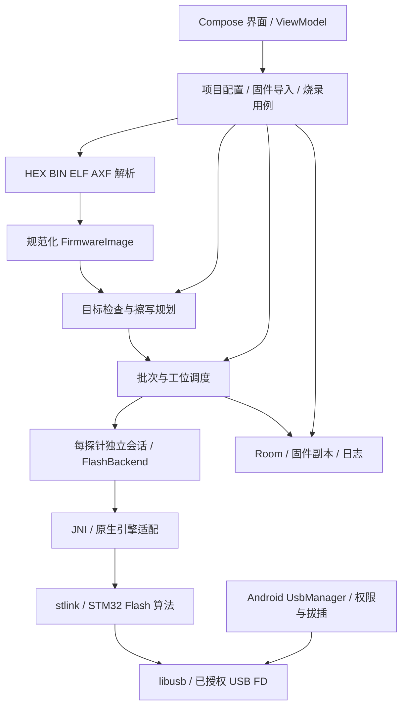

# Corn Flashing — Android 烧录工具架构规划

状态：架构提案，尚未实现或通过真实硬件验证。

## 1. 目标与边界

- Android 手机/平板离线运行，通过 USB Host / OTG 连接烧录器，无 Root 作为设计目标。
- 首个验证组合：一台指定 Android 设备、一只实际 ST-LINK/V2、一款确定完整料号的 STM32F103。
- 固件格式：Intel HEX、BIN、受支持的 ELF32 ARM 可执行文件，以及实际内容满足同样约束的 AXF。
- 自动探测设备组、修订、Flash 容量和可读取的 UID；不宣称由这些字段还原完整订货型号。
- 第一阶段单路手动触发、连续换板；第二阶段增加多路并行。ST-LINK/V2-1、V3 按实际硬件逐个验证。
- 默认不修改读保护、Option Bytes、OTP，不自动解除保护或自动执行整片擦除。
- 不依赖在线服务；固件、配置、日志保存在设备本地。

最低 Android 版本与 ABI 在硬件验证后确定；优先验证 arm64-v8a。Android 10 可作为初始最低版本候选，并非已确认兼容范围。

## 2. 关键技术决策

| 决策 | 方案 | 代价与约束 |
| --- | --- | --- |
| UI | Kotlin + Jetpack Compose | 手机与平板共用响应式页面，需要管理 Android 生命周期 |
| 核心路线 | NDK/JNI + 评估移植 stlink + libusb | 复用协议与 Flash 实现，但要适配 Android 文件描述符和库上下文 |
| 备选路线 | Kotlin USB 传输 + 自行实现所需 ST-LINK 命令与 F103 Flash 算法 | Android 集成直接，但协议维护、算法和兼容性验证工作更多 |
| 任务管理 | Kotlin 协程；每个探针独立串行会话 | 原生调用须有超时，协程取消不能直接当作原生调用已停止 |
| 文件模型 | 所有格式统一成有地址的数据区段 | ELF/AXF 必须明确支持的布局，不猜测地址 |
| 持久化 | Room 保存项目、任务、事件；应用私有目录保存固件副本 | 需要文件与数据库一致性检查、日志保留策略 |
| 运行方式 | 用户在前台启动 connectedDevice 类型前台服务 | 服务适配目标 Android 版本；不保证进程永不被系统终止 |

首选路线在 P0 通过后才锁定；stlink 不是现成 Android SDK。不得假定其多会话路径已线程安全。复用依赖前记录版本、许可证和必要声明。

## 3. 总体结构



硬件链路：Android → OTG/供电 Hub → ST-LINK → SWD → 目标板。目标板供电独立确认；不得默认由探针提供。多路并行需每块板有独立探针，不能把一组 SWD 线直接并联到多块板实现独立编程。

## 4. 模块职责

初期采用单一 Android app 模块加 native 库，在包边界上分工，避免提前拆成大量 Gradle 模块。

```text
app/src/main/java/.../
  ui/                 项目、固件、设备、烧录、批量、记录页面
  firmware/           格式检测、解析、规范化、哈希与地址检查
  project/            产品配置、允许操作范围、BIN 地址与擦除策略
  flashing/           烧录计划、状态机、批次调度、错误类型
  backend/            FlashBackend 接口、JNI 适配、模拟后端
  usb/                Android 权限、发现、连接所有权、拔插事件
  service/            前台服务、任务生命周期和通知
  storage/            Room、私有固件文件、导入导出
app/src/main/cpp/
  bridge/             JNI 与会话句柄
  android_usb/        已授权 FD 接入、原生 USB 生命周期
  engine/             对上游烧录库的适配
docs/                 架构、兼容矩阵、验证证据、依赖说明
```

依赖原则：界面调用用例；烧录用例依赖抽象后端，不直接调用 JNI；格式解析不依赖 USB 或界面。原生层只返回结构化结果和进度，不操作数据库或界面。

## 5. 数据与接口

| 对象 | 核心字段 |
| --- | --- |
| FirmwareArtifact | 原文件名、文件哈希、格式、应用私有副本 |
| FirmwareImage | 地址与数据区段、有效字节数、可选入口信息、解析器版本、规范化内容摘要 |
| TargetInfo | 原始 Device/Revision ID、设备组、报告的 Flash 容量、可选 UID、识别置信状态 |
| ProbeInfo | USB VID/PID、可用序列号、固件版本、当前连接实例标识 |
| ProductProfile | 允许设备组与容量、可写范围、保留范围、BIN 起始地址、连接与擦除/复位策略 |
| FlashPlan | 固件摘要、配置版本、目标快照、擦除页、写入块、校验范围 |
| FlashJob | 任务 ID、批次、工位、计划、状态、时间、结构化错误、各步骤证据 |

FlashBackend 的最小能力：打开指定探针、连接目标、探测、读内存、按计划擦除、写入、校验、复位、关闭。每项必须返回明确结果，支持进度和有界超时；不向 UI 暴露原生指针。

固件导入后复制到应用私有目录，校验并固定哈希。任务开始时冻结配置和固件引用；执行过程中切换页面、选择其他固件不得改变正在执行的任务。

## 6. 固件格式策略

- 文件头与实际内容参与识别，扩展名仅作提示；限制文件大小、记录数量、区段数量及地址运算范围。
- HEX：校验记录长度、校验和、扩展地址、结束记录及重叠。支持明确的记录类型，对不支持或含糊的内容返回原因。
- BIN：必须由产品配置或用户明确给定加载地址。0x08000000 可以作为 F103 无 Bootloader 配置的建议值，不能静默应用于所有产品。
- ELF/AXF：首版范围为 ELF32、小端、ARM、受支持的可执行布局。优先按可加载段解析，并结合明确的 LMA/VMA 规则识别 Flash 存储内容。初始化 RAM 数据的 Flash 副本应纳入；BSS 不按内存大小补零写入 Flash。调试信息不参与烧录。
- 对 ELF 中 p_paddr、p_vaddr 或段/节布局无法明确确定 Flash 加载范围的情况，拒绝猜测，并提示导出 HEX/BIN。不要简单忽略所有 VMA 位于 RAM 的区段。
- 用真实 Keil/GCC 等工具链的成对 ELF/AXF 与 HEX/BIN 样本验证规范化结果；兼容声明按工具链和实际文件布局记录。
- 每个实际擦除页都要检查，包括固件未覆盖的页内字节。HEX 的空洞不代表可以清空；首版遇到需要保留的同页内容，拒绝执行并说明冲突。读改擦写另立后续功能。
- 默认只允许配置内的内部 Flash，外部 Flash、Option Bytes、OTP 和任意 RAM 下载不在第一版支持范围。

## 7. USB 与原生核心

1. UsbManager 发现设备，由用户授予当前 USB 设备访问权限。
2. Android 层打开 UsbDeviceConnection，获取 FD；原生层通过 libusb_wrap_sys_device 等受支持路径接入。
3. 为 stlink 增加“使用已打开设备句柄”的适配入口，不能让其另行扫描并尝试未经授权地打开所有 USB 设备。
4. 明确 FD、UsbDeviceConnection、libusb handle 和 JNI 会话句柄的所有权；会话退出后按固定顺序释放，避免提前关闭或重复关闭。
5. 一个探针同一时间仅属于一个任务；同一会话不得由 Java USB API 与 libusb 同时读写。
6. USB 断开立即标记会话失效，等待有界原生调用退出后释放资源，不复用旧句柄。

真实探针序列号可用于工位映射，但可能缺失或重复。Android USB deviceId 仅适合作当前连接标识，不作为跨拔插永久身份；无法唯一匹配时要求重新确认工位。首版可仅提供单路连续烧录，避免依赖不可靠的物理 USB 端口识别。

## 8. 任务状态与错误恢复

```text
排队 → 等待授权/设备 → 连接 → 探测 → 生成并检查计划
     → 擦除 → 写入 → 校验 → 复位 → 成功

任一阶段 → 失败 / 取消 / 中断待重新处理
```

- 成功默认指全部要求步骤完成；Flash 校验通过与复位失败分别记录。程序启动后的功能测试是另一个可选步骤，不由 Flash 校验推断。
- 擦写前持久化任务意图与计划摘要，完成后写入结果。进程重启时，把未终结任务标记为中断/结果未知，不自动续写或计为成功。
- 取消属于协作停止：当前有界 Flash 操作结束后停止调度下一块。不得把关闭协程当作硬件操作已经终止。
- 连接阶段可做有限次数重试；擦写之后的失败先记录目标可能已改变，重连并重新探测，再由用户决定是否重新执行完整计划。
- 错误区分：USB 未授权、探针打开失败、目标无响应、未知设备、容量读取异常、配置不匹配、地址越界、保留区冲突、保护状态阻止操作、擦写超时、校验不一致、复位失败、USB 断开。
- 未知或疑似兼容芯片不自动套用 F103 算法；自动识别不用于证明真伪或确定完整料号。

前台服务承载活动任务，UI 通过 StateFlow 订阅状态。服务按 Android connectedDevice 规则配置；屏幕旋转或 UI 重建不应丢失任务，系统终止进程则按中断流程处理。WorkManager 不承担正在进行的 USB 烧录。

## 9. 批量设计

### 单路连续换板

固定固件与产品配置；每次换板后手动开始，每块板重新探测。分别统计尝试次数、成功任务数、失败任务数和已验证 UID 的唯一成功板数。UID 不可读时不声称已完成精确去重。相同 UID 可明确执行返修重烧，不把去重变成不可绕过的限制。

### 多路并行

每个工位拥有独立会话、任务状态和进度；每个任务绑定固定探针。先验证两路，再扩大到四路。只有确认原生库的全局状态、libusb 上下文、回调与取消路径不互相干扰后，才启用真正并发；否则串行运行或后续引入进程隔离。一路断开不能终止其他工位。并发上限由实际手机、Hub、探针和板卡组合验证决定。

## 10. 交付阶段与验收

| 阶段 | 交付 | 通过条件 |
| --- | --- | --- |
| P0 技术验证 | 最小 Android 验证 APK | 指定硬件上无 Root 获得权限、连接 V2、读取 F103 信息，并完成已知固件擦写、校验和重连；确认 native 库能使用 Android 授权 FD |
| P1 单机闭环 | HEX/BIN 导入、产品配置、计划检查、单次烧录、记录 | 用已知固件对照验证写入内容；越界和保留区冲突在擦除前拦截；拔插/失败后可以重新执行 |
| P2 文件兼容与连续批量 | ELF/AXF、连续换板、统计、导出 | 真实工具链样本与对应 HEX/BIN 内容一致；重复板与失败任务计数准确；中断不误报成功 |
| P3 多路与扩展 | 多路面板、并发调度、V2-1/V3 | 两路独立执行和故障隔离通过，再按兼容矩阵扩展到更多路数和探针 |

第一版正式可用范围以 P2 为目标，P0 作为继续投入完整 UI 的技术门槛；不以仅能枚举 USB 设备作为 P0 完成。

## 11. 验证策略

- 纯逻辑测试：损坏 HEX、地址溢出、区段冲突、BIN 边界、ELF 截断/畸形头、初始化数据、擦除页与保留区冲突。
- 后端模拟：超时、断开、校验失败、取消、任务重启恢复和统计；模拟结果不代表 USB 真机兼容。
- Android 模拟器：文件导入、界面、数据库、生命周期和模拟任务流程。
- 真实硬件：USB 授权、原生 FD 接入、SWD、擦写校验、重连、不同探针和多路稳定性。模拟器不能替代这些验证。
- 建立矩阵：Android 型号/系统、探针型号/固件、完整芯片料号、目标板、固件格式/工具链、并发路数及测试证据。

## 12. 尚待确定

- 首个真实 STM32F103 完整料号及板卡是否包含 Bootloader/保留参数。
- 实际 Android 测试设备和系统版本、ST-LINK/V2 硬件与固件版本。
- ELF/AXF 来源工具链及代表性样本。
- 首个多路目标是两路还是四路，以及供电 Hub 和治具方案。

这些不阻止先建立项目骨架和解析模型，但影响硬件兼容承诺与正式验收范围。

## 13. 官方与上游参考

- Android USB Host：https://developer.android.com/develop/connectivity/usb/host
- Android 前台服务类型：https://developer.android.com/develop/background-work/services/fgs/service-types
- libusb Android 接入与 FD 示例：https://github.com/libusb/libusb/blob/master/android/README
- stlink 开源项目与许可证：https://github.com/stlink-org/stlink
- ST CubeProgrammer 平台与生产定位说明：https://dev.st.com/stm32cube-docs/prog/2.23.0/en/docs/markup/CubeProg_FAQ.html

CubeProgrammer 不作为此 Android 方案的运行时依赖。
