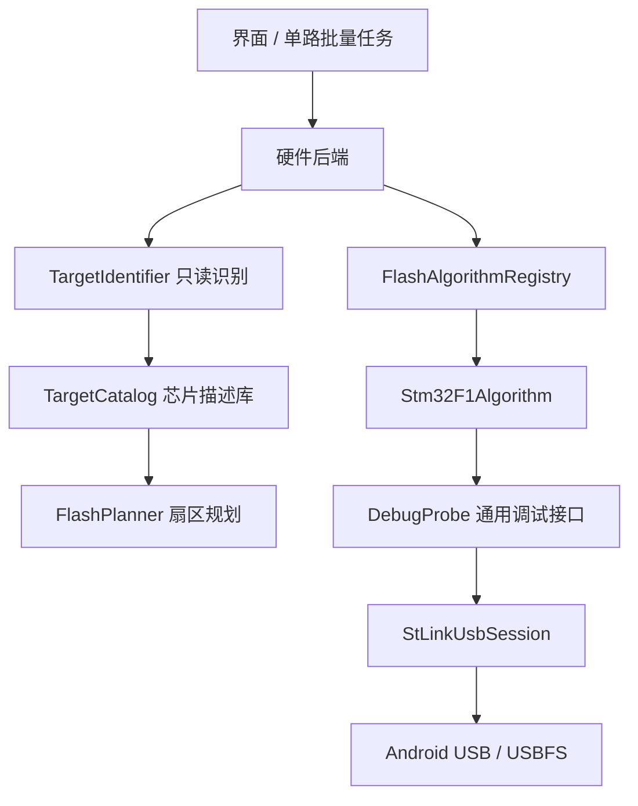

# 可扩展烧录引擎：第一阶段

## 已实现的边界

- `DebugProbe`：内存宽度、核心寄存器、停核/运行、软件复位；不包含芯片 Flash 寄存器。
- `ProbeInfo`：现场探针类型、固件版本、USB策略及能力。USB授权和能够识别芯片不等于允许烧录。
- `TargetIdentifier`：先读CPUID，根据登记核心选择DBGMCU地址，再匹配device ID，按芯片描述读取16位容量与UID。未知核心/设备组明确拒绝，不回退F1。
- `TargetCatalog`：UTF-8 Properties资源，带schema版本；描述核心、RAM、识别寄存器、容量、Flash地址、扇区和算法ID。设备组不是完整订货料号，同一ID可能覆盖多个型号。
- `FlashPlanner`：根据扇区列表规划，支持非等长扇区，检查完整擦除范围与保留区；显式产品配置的地址约束保留。AUTO_DETECT接受描述给出的基址。
- `FlashAlgorithmRegistry`：只分派已安装算法，目标容量/状态和探针能力在擦除前验证。
- `Stm32F1Algorithm`：首个实际驱动，复用原J23 RAM STRH loader与J26+原生半字路径。F1特有Flash寄存器、看门狗冻结与清理位于此驱动中，USB层不再执行F1算法。

## 当前目录

| 设备组 | 数据库名称 | 功能状态 | 实板证据 |
|---|---|---|---|
| 0x412 | STM32F1 小容量，16/32KB | F1单Bank算法接入 | 未实测 |
| 0x410 | STM32F1 中容量，64/128KB | F1单Bank算法接入 | 未实测 |
| 0x414 | STM32F1 大容量，256/384/512KB | F1单Bank算法接入 | 256KB + V2J23S4 + Xiaomi Android17已验证 |
| 0x430 | STM32F1 超大容量，768/1024KB | 仅识别，双Bank算法未接入 | 未实测 |
| 0x448 | STM32F072/F078，64/128KB | 识别描述/只读流程已接入，不开放擦写 | 模拟寄存器测试，未实板验证 |
| 0x413 | STM32F405/F407/F415/F417，512/1024KB | 识别描述/只读流程已接入，不开放擦写 | 模拟寄存器测试，未实板验证 |

这份清单区分“算法已接入”与“指定组合实测”。不支持的算法即使资源中有容量/扇区信息，也会在规划和分派两个阶段拒绝擦除。V3暂不继承V2的编程能力声明。

## 添加一个芯片组

1. 根据官方参考手册/设备头文件登记设备组、核心、容量/UID地址、最低可用RAM及完整扇区布局。
2. 若没有实际驱动，将support设为IDENTIFY_ONLY且algorithm=none，先测试只读识别。
3. 实现FlashAlgorithm并在后端registry注册唯一ID；对probe能力和目标进行擦除前检查。
4. 增加未知ID、异常容量、非等长扇区、保留区与未安装算法拒绝测试。
5. 用真实板验证擦除、写入、全量回读、复位、取消/断连，记录具体探针固件和手机系统。

新增描述资源不会自动安装或授权Flash算法，实际支持不能只靠增加一行型号数据。

## 兼容已有项目

F103_OPEN与旧模板字段保持；AUTO_DETECT对已对齐的内置F1组仍生成旧f103-0x... ID与相同configSha256，避免仅因框架重构使旧F1批次无法恢复。新增识别组和新算法不会改变已冻结批次的型号/固件一致性检查。

## 后续阶段：CMSIS-Pack / FLM

第一阶段的后续计划已在test11落实解析与执行基础，见[第二阶段实现与限制](cmsis-pack-flm.md)。下列条目为原规划，实际支持范围以第二阶段文档和验证记录为准：

- 解析PDSC器件/内存/算法关联以及FLM ELF段、符号和FlashDevice信息。
- 校验算法RAM代码、静态数据、栈、缓冲区布局和所有入口地址，不与目标数据重叠。
- 统一Init/UnInit/EraseSector/ProgramPage调用ABI，检查返回值、断点与超时，提供设备特定初始化钩子。
- 用受控算法与实板测试验证后，才向目标目录注册可烧录状态。
- 下载/导入时固定包版本与哈希；烧录过程使用本机已验证资源，无网络依赖。

## 一手参考

- [Open-CMSIS-Pack Flash算法规范](https://open-cmsis-pack.github.io/Open-CMSIS-Pack-Spec/main/html/flashAlgorithm.html)
- [FLM算法函数接口](https://open-cmsis-pack.github.io/Open-CMSIS-Pack-Spec/main/html/algorithmFunc.html)
- [pyOCD Pack支持](https://pyocd.io/docs/open_cmsis_pack_support.html)
- [ST STM32F072设备头文件](https://github.com/STMicroelectronics/cmsis-device-f0/blob/master/Include/stm32f072xb.h)
- [ST STM32F407设备头文件](https://github.com/STMicroelectronics/cmsis-device-f4/blob/master/Include/stm32f407xx.h)
- [ST RM0090](https://www.st.com/resource/en/reference_manual/dm00031020-stm32f405-415-stm32f407-417-stm32f427-437-and-stm32f429-439-advanced-arm-based-32-bit-mcus-stmicroelectronics.pdf)
